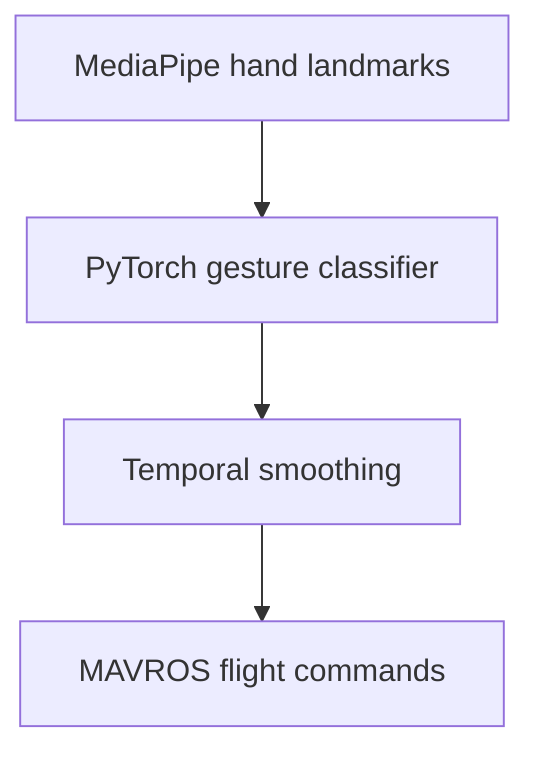

# Autonomous Drone Swarm — Case Study

**Cornell Autonomous Drone Project Team (CUAD) · Software Developer · September 2025–present**

I develop software for a four-drone autonomous swarm competing in the International Aerial Robotics Competition.

## My contributions

- Developed and flight-tested ROS 2 perception, planning, and multi-agent coordination software.
- Integrated visual odometry, camera-based obstacle avoidance, and D* Lite replanning on a Raspberry Pi 5 for flight without GPS.
- Trained and deployed a PyTorch gesture classifier using MediaPipe hand landmarks and temporal smoothing.
- Connected recognized gestures to swarm arming, takeoff, and landing commands through MAVROS.

## Gesture-control workflow

I worked on training and deploying the gesture model, connecting its output to flight commands, and testing the system in flight.

## Public team code

The team's [GestureDrone repository](https://github.com/CUAutoDrone/GestureDrone) includes code for collecting gesture data, training and running models, and integrating them with ROS:

- [Gesture pipeline](https://github.com/CUAutoDrone/GestureDrone/tree/main/GestureData%28IARC%29)
- [ROS integration](https://github.com/CUAutoDrone/GestureDrone/tree/main/Gesture_to_flight%28ROS%29)

**About the code:** GestureDrone is a shared team repository with several development versions. My contributions are described above; the linked code includes work by other team members.

**Technologies:** Python, ROS 2, Raspberry Pi 5, D* Lite, PyTorch, MediaPipe, MAVROS

[Back to my profile](https://github.com/emoryv)
