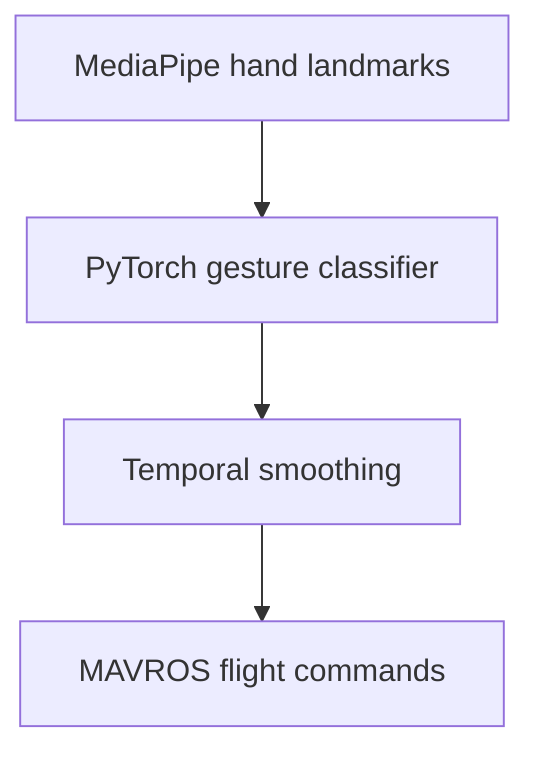

# Autonomous Drone Swarm — Case Study

**Cornell Autonomous Drone Project Team (CUAD) · Software Developer · September 2025–present**

Software contributions to a four-drone autonomous swarm competing in the International Aerial Robotics Competition.

## My contributions

- Developed and flight-tested ROS 2 perception, planning, and multi-agent coordination software.
- Integrated visual odometry, camera-based obstacle avoidance, and D* Lite replanning on a Raspberry Pi 5 for GPS-denied flight.
- Trained and deployed a PyTorch gesture classifier using MediaPipe hand landmarks and temporal smoothing.
- Connected recognized gestures to swarm arming, takeoff, and landing commands through MAVROS.

## Gesture-control workflow

The subsystem connects visual classification to physical-system behavior. My role included model training, deployment, command integration, and flight testing.

## Public team code

[CUAD GestureDrone](https://github.com/CUAutoDrone/GestureDrone) contains the team's gesture collection, training, inference, and ROS integration work:

- [Gesture pipeline](https://github.com/CUAutoDrone/GestureDrone/tree/main/GestureData%28IARC%29)
- [ROS integration](https://github.com/CUAutoDrone/GestureDrone/tree/main/Gesture_to_flight%28ROS%29)

**Source and attribution:** This case study describes my contribution to a team system. The linked repository contains multiple development iterations and preserves its authors' commit history; it provides team implementation context rather than file-level attribution to me.

**Technologies:** Python, ROS 2, Raspberry Pi 5, D* Lite, PyTorch, MediaPipe, MAVROS

[Back to my profile](https://github.com/emoryv)
